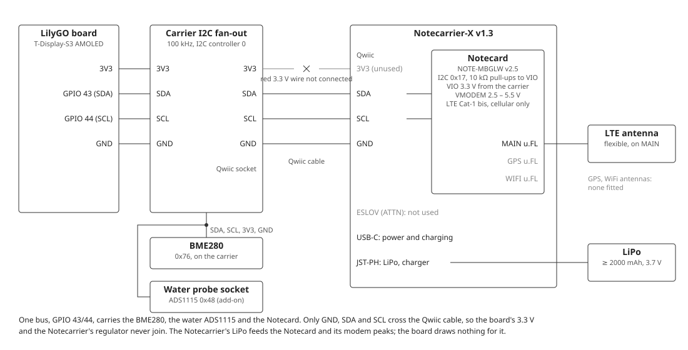
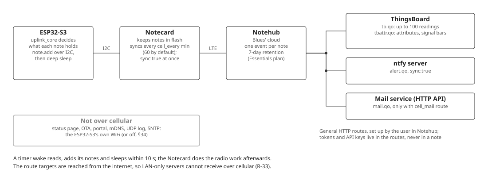

# Blues cellular uplink

The hardware for the cellular uplink of FSD §33: a Blues Notecard Cell+WiFi
**NOTE-MBGLW**, hardware v2.5, on a **Notecarrier-X v1.3**, both parts the user owns.
The device runs the Notecard on cellular only (FR-33.14), and, when `gps` is `on`,
uses its GPS once per setup check to take a fix of the place (FR-33.15). The FSD specifies it, but
neither the firmware nor the wiring is built yet. The Notecarrier joins the I2C bus in one
of two ways (FSD §33.2, Wiring): by a Qwiic cable, with nothing soldered, or by three
wires soldered to its 16-pin header. Fritzing [sheet 5](wiring/wiring-5-blues-cellular.png)
shows the Qwiic wiring, [sheet 6](wiring/wiring-6-blues-cellular-direct.png) the direct
wiring, and sheet 1 the Notecarrier beside the BME280.

The Notecarrier is not an add-on board on a JST-XH socket. It plugs into the carrier's
Qwiic socket, listed in [wiring.md](wiring/wiring.md#carrier-and-add-on-boards), and
brings its own power. The [User Manual, 5g](../../UserDocumentation/User-Manual.md#5g-placing-the-cellular-antenna)
covers placing the antenna. Figures come from Blues' published pages listed under
Sources; check them against the current ones.

## Parts

| Ref | Function (FSD §33.2) | Part | Notes |
|-----|----------------------|------|-------|
| U2 | Modem | Blues Notecard Cell+WiFi NOTE-MBGLW v2.5, M.2 key E: LTE Cat-1 bis, global bands, 500 MB and 10 years of service included | I2C 0x17, 10 kΩ pull-ups to its VIO. Its WiFi stays unused (FR-33.14) |
| U2 | Carrier | Blues Notecarrier-X v1.3: M.2 socket, USB-C, JST-PH LiPo connector and charger, Qwiic and ESLOV I2C connectors | No onboard antenna. ESLOV also carries ATTN, which this device does not use |
| AE1 | LTE antenna | Flexible LTE antenna with a u.FL lead, such as Blues' flexible LTE antenna | On the Notecard's `MAIN` port. Required: the carrier has none |
| AE2 | GPS antenna, optional | The GPS part of Blues' combined LTE + GPS flexible antenna, or a single passive GPS antenna, u.FL | On the Notecard's `GPS` port, only with `gps` `on`. Never cut the combined antenna |
| BT2 | Notecard supply | LiPo cell, 3.7 V, at least 2000 mAh, JST-PH 2.0 mm, protected | Check the JST-PH polarity: makers wire it both ways |
| W1 | Bus link, Qwiic wiring | Qwiic (JST-SH 4-pin) cable, 100 – 200 mm | Its red 3.3 V wire is cut or pulled from the plug at the carrier end |
| W2 | Bus link, direct wiring | Three wires, 24 – 26 AWG stranded, or a 0.1" pin header on the Notecarrier and Dupont leads | GND, SDA, SCL only; twist SDA and SCL with GND |

### Why this Notecard

| | NOTE-MBGLN (cell only) | **NOTE-MBGLW (Cell+WiFi, used)** | Notecard WiFi v2 (NOTE-ESP) |
|---|---|---|---|
| Radio | LTE Cat-1 bis, global | LTE Cat-1 bis, global, plus 2.4 GHz WiFi | 2.4 GHz WiFi only |
| Idle current | about 9 µA | about 18 µA | Not low by default. It has an ESP32 inside, and its ~10 µA deep sleep turns off I2C. |
| One isolated sync | 0.261 mAh | 0.284 mAh | n/a |
| 12 h with 30-min syncs | 8.86 mAh | 10.12 mAh | n/a |
| Data | 500 MB / 10 years included | 500 MB / 10 years included (WiFi traffic doesn't use it) | No cellular |
| Antennas | `MAIN` u.FL (LTE) | `MAIN` u.FL, plus an onboard WiFi antenna and a `WIFI` u.FL | Embedded only |

The WiFi-only Notecard doesn't fit this device: it has no cellular, it doesn't idle at
low current, and it can't take over anything the ESP32-S3's WiFi does. The MBGLW costs
nothing extra because the user already owns it, and its idle current is still small
next to the board's. Its WiFi, with Blues' default order of WiFi first and cellular as
fallback, is out of scope for now (FSD §4.3); it is a later option for sites with an
unreliable access point.

## Connections

| From | To | Signal |
|------|----|--------|
| Carrier Qwiic socket pin 1 (GND) | Notecarrier-X Qwiic GND | GND |
| Carrier Qwiic socket pin 2 (3V3) | nothing | The cable's red wire stays unconnected |
| Carrier Qwiic socket pin 3 | Notecarrier-X Qwiic SDA | GPIO 43, SDA |
| Carrier Qwiic socket pin 4 | Notecarrier-X Qwiic SCL | GPIO 44, SCL |
| Notecard `MAIN` u.FL | AE1 | LTE RF |
| Notecard `GPS` u.FL | AE2, only with `gps` `on` | GPS RF |
| Notecarrier-X JST-PH | BT2 | LiPo, charged from USB-C |
| Notecard `WIFI` u.FL; ESLOV; Notecarrier headers | nothing | Unused |

### Direct wiring

The alternative to the Qwiic cable (sheet 6). The Notecarrier-X's 16-pin header carries
the same bus; its left column ends with `SCL`, `SDA` and `GND`.

| From | To | Signal |
|------|----|--------|
| Carrier I2C fan-out GND | Notecarrier-X header `GND` | GND |
| Carrier I2C fan-out SDA | Notecarrier-X header `SDA` | GPIO 43, SDA |
| Carrier I2C fan-out SCL | Notecarrier-X header `SCL` | GPIO 44, SCL |
| BT2 + and −, optional | Notecarrier-X header `VBAT` and `GND` | LiPo, instead of the JST-PH |
| Header `VIO`, `ATTN`, `EN`, `NRST` and the rest | nothing | Unused |

`VIO` is the Notecard's own 3.3 V output: tying it to the board's 3.3 V would join the
two regulators, as the Qwiic cable's red wire would. Never connect `EN` or `NRST`: `EN`
pulled to GND turns the Notecard off, and `NRST` is for development only. With BT2 on
`VBAT`, the Notecarrier's charger still charges it from USB-C; use a protected cell, and
leave the JST-PH empty.

On the bench, sheet 5 takes the bus from the board's own Qwiic connector, which carries
the same GPIO 43/44. In the build, the carrier's I2C fan-out feeds the BME280, the water
socket and the Qwiic socket, so the board's Qwiic connector stays free.

## Circuit details

### Shared bus

The Notecard sits at 0x17 on the bus that also carries the BME280 (0x76) and the water
ADS1115 (0x48), at 100 kHz (C-23.1). The Notecarrier-X's LiPo charger, a TI BQ25628E,
shares the Notecard's I2C lines at 0x6A, fixed in the chip, so it answers on this bus
whenever the Notecarrier is fitted. The firmware never addresses it. The loop
ADS1115 (0x49) has its own bus (I2C port 1). None of these addresses clash, and a part
added to this bus must avoid 0x17, 0x48, 0x6A and 0x76 (0x77 is the BME280's other
address). Its 10 kΩ pull-ups to VIO add to the breakouts'
own, so keep the parallel total at or above about 2.2 kΩ, removing a breakout's
pull-ups if needed. The device polls the Notecard: no ATTN line is wired.

### Separate supplies

The Notecard never draws from the board. The Notecarrier's own LiPo, or its USB-C,
feeds the modem, whose peaks of up to about 2 A would brown out the board's 3.3 V
regulator. Only GND, SDA and SCL cross the cable, so the board's 3.3 V and the
Notecarrier's regulator are never tied together, and the shared ground keeps the I2C
levels referenced. The Notecard's VIO is 3.3 V from the carrier, the same level as the
board's bus.

### GPS at setup

The Notecard's GPS and its modem never run together, and the GPS turns on only after
the Notecard's first completed Notehub sync. So the device starts the search after the
setup check's time step, keeps it for the hold, and, on a fix, sends
`card.location.mode` `fixed` with the place: the GPS turns off, and Notehub tags later
events with it. A cold first fix takes 1 – 2 minutes with a view of the sky; the
Notecard gives a seek up after about 17 minutes, or after 90 s with no signal at all
(R-35).

`card.location` answers with the last location the Notecard holds: an earlier GPS
fix, the cell tower location of its last session, or the place given with `fixed`,
each with its own `time` and often with `{gps}` in the status. Right after
`continuous` it still answers with that held location. So the search counts a fix
only when it is a GPS fix taken after the search began (FR-33.16), else it would end
at once on the held place. The `gps` test (FR-33.20, `setup=<id>,gps` over BLE or
the portal) runs the same search without a factory reset.

### Always powered

The Notecard stays powered through deep sleep (FR-33.5) and idles at about 18 µA.
Blues advises against power-cycling it, because each cold start re-registers on the
network, so nothing on the board switches it.

## Budgets

| Budget | Figure | Note |
|--------|--------|------|
| Notecard idle | about 18 µA | From the Notecarrier's LiPo, not the board's |
| One sync, idle included | about 0.42 mAh | Blues' 30-minute test |
| Hourly syncs (`cell_every` 60) | about 10 mAh a day | Each `sync:true` alert or email adds a session; weak signal costs more |
| BT2 runtime | about 6 months on 2000 mAh | Between charges; `cell_every` 240 cuts the sync cost about 4×, with readings up to 4 h late |
| GPS | at most one seek per setup check, about 17 min at the longest | From BT2; off the rest of the time (FR-33.15) |
| Modem peaks | up to about 2 A | Carried by BT2 and the Notecarrier's regulator |
| Board current | none | Only the I2C pull-ups' share while the bus is driven |
| Data | about 1 – 2.5 MB a month at hourly syncs | Blues measured 1.3 – 3.5 KB per sync of up to 100 notes; NFR-33.2 allows 4 MB |
| Notehub events | about 720 `tb.qo` events a month, plus alerts, email and attributes | The free Essentials plan gives 5,000 event credits a month and keeps events 7 days; routing costs no extra credit |
| Wake time | asleep within 10 s of a timer wake | NFR-33.1: the device adds its notes and sleeps; the Notecard syncs afterwards |

## Sending

What the firmware does with `uplink` `cell` (FSD §33.5):

1. On each boot, install the Notecard's I2C device and ask `card.version`. No answer
   within 2 s is L44, and that boot's sends fail (FR-33.4, FR-33.10).
2. Send `hub.set` (`product`, `mode` `periodic`, `outbound` `cell_every`, `inbound`
   1440) only when the Notecard's stored values differ (FR-33.4).
3. Set `card.transport` to `cell` when the Notecard reports another transport
   (FR-33.14).
4. On a boot whose clock was never set, ask `card.time`. In a window, request one
   `hub.sync` and ask again every 5 s for up to 60 s; on a timer wake ask once
   (FR-33.12).
5. In a setup check with `gps` `on`, send `card.location.mode` `continuous` and ask
   `card.location` every 5 s. On a fix, store it, send `fixed` with it and log L45;
   at the end of a hold without one, send `fixed` with the stored place or `off`, and
   log L45 `none`. Line 6 shows the search meanwhile (FR-33.16 – FR-33.19).
6. Add the due notes with `note.add`: `tb.qo` batches of at most 100 readings, then
   `tbattr.qo`; `alert.qo` and `mail.qo` with `sync:true` (FR-33.6 – FR-33.8). Each
   accepted note is L43, each refused one L44.
7. Move the upload mark past each accepted batch (FR-33.7), and sleep within 10 s of the
   wake (NFR-33.1).

Notehub reaches the route targets from the internet, so the LAN test servers can't
receive over cellular (R-33). The tokens and the mail API key live in the routes, never
in a note (FR-33.9).

## To check before wiring

1. **Carrier version.** Blues' datasheet covers the Notecarrier-X v1.2. Check the v1.3
   board's Qwiic pin order, header labels (`GND`, `SDA`, `SCL`, `VBAT`), header pitch,
   JST-PH polarity and charger against it.
2. **The red wire, or `VIO`.** With the Qwiic cable plugged into the carrier only,
   check with a meter that its 3.3 V pin reaches nothing at the Notecarrier end. With
   direct wiring, check that nothing touches the header's `VIO`, `EN` or `NRST`.
3. **Pull-ups.** With every board fitted and nothing powered, measure SDA to 3V3 on the
   carrier: at least 2.2 kΩ.
4. **An unpowered Notecarrier.** With BT2 unplugged and USB-C off, the Notecard's
   pull-ups go to a dead VIO. Check that the BME280 still reads; if not, fit the
   Notecarrier only with its supply on.
5. **The antenna first.** Fit AE1 on `MAIN` before powering the Notecarrier: the modem
   must not transmit without a load.
6. **AE2, when used.** Fit it on `GPS`, not `MAIN`: the two u.FL ports sit side by
   side.
7. **BT2's plug.** Check the LiPo's JST-PH polarity against the Notecarrier's marking.

## Bring-up

Run [`commissioning/notecard-probe`](../../../commissioning/notecard-probe/main/main.c)
(FSD §3.15) before the first cellular bench test. It talks to the Notecard on GPIO 43/44
beside the BME280 and, once after reset:

- scans the bus (0x17, 0x76, the charger's 0x6A and, with the water board fitted,
  0x48 must answer);
- reads `card.version`, `card.transport`, `hub.get`, `card.wireless` (the signal bars)
  and `card.time`;
- with a ProductUID set, sends `hub.set` and `card.transport` `cell` where the Notecard
  differs (FR-33.4, FR-33.14);
- adds one note of 100 readings and one of 50, shaped as `tb.qo` batches, to `probe.qo`
  (no route takes that file), and prints each note's size and how long `note.add` took,
  which must fit in NFR-33.1's 10 s at 100 kHz, else the batch limit is 50 (FR-33.7);
- optionally forces one sync and prints `card.usage.get` before and after it, to compute
  the monthly figure for NFR-33.2 from a measurement;
- optionally, with AE2 fitted, turns the GPS on and prints the `card.location` status
  every 5 s until a fix (up to 20 min), to time a cold fix at the bench window.

Its options are under "Notecard probe" in `idf.py menuconfig`: the ProductUID, the
forced sync and the GPS seek. Without a local toolchain, run the "Commissioning aids"
workflow by hand: its `notecard_product`, `notecard_sync` and `notecard_gps` inputs set
the same options in the `notecard-probe` artefact. Lines start with `notecardprobe:`; `CHECK` marks a result
to look at.

Without a ProductUID the Notecard refuses every `note.add` (`{product-noexist}`), so
the batch timing needs one. On the bench Notecard (capability `dut-notecard` in
[`test-plan.yaml`](../../../testing/test-plan.yaml)) a note of 100 readings takes about
6.9 s and one of 50 about 3.4 s, so notes keep 100 readings (FR-33.7). At the bench
window the Notecard gets LTE at 1 bar and a GPS fix within about a minute of the
search starting.

A timer wake is too short for the board's USB port to come up, so the bench sees no
log from it. Check timer wakes by their readings in `/api/history` after a key wake,
or with the sleep test builds.

## Installation

Mount AE1 per the [User Manual, 5g](../../UserDocumentation/User-Manual.md#5g-placing-the-cellular-antenna):
long axis vertical, on the inside of a plastic enclosure wall, at least 10 mm from
metal, the LiPo and both PCBs, its coax clear of the AMOLED's QSPI lines and the
ESP32-S3's antenna. Check the fit by the signal bars in `tbattr.qo` with the enclosure
closed. With `gps` `on`, give AE2 the best view of the sky the site allows (the
upper wall facing a window, or outdoors), and run the setup check with the box in place,
so the fix is the place where it stands. Keep USB-C on the Notecarrier reachable, or route it out, to charge BT2.

## Sources

- [Blues: NOTE-MBGLW datasheet](https://dev.blues.io/datasheets/notecard-datasheet/note-mbglw/)
- [Blues: Notecarrier X v1.2 datasheet](https://dev.blues.io/datasheets/notecarrier-datasheet/notecarrier-x-v1-2/) ([16-pin headers](https://dev.blues.io/datasheets/notecarrier-datasheet/notecarrier-x-v1-2/#dual-16-pin-headers))
- [Blues: Low-Power Firmware Design, power usage estimates](https://dev.blues.io/notecard/notecard-walkthrough/low-power-firmware-design/#power-usage-estimates)
- [Blues: Notecard WiFi v2 deep sleep](https://dev.blues.io/notecard/notecard-walkthrough/low-power-firmware-design/#deep-sleep-mode-on-notecard-wifi-v2)
- [Blues: Cell+WiFi, WiFi first with cellular fallback](https://dev.blues.io/blog/next-generation-of-notecards/#wifi-connectivity-with-a-fallback-to-cellular)
- [Blues: Time and location requests, GPS](https://dev.blues.io/notecard/notecard-walkthrough/time-and-location-requests/#working-with-gps-on-the-notecard)
- [Blues: Diagnosing GPS issues](https://dev.blues.io/support/diagnosing-gps-issues/)
- [Blues: Antenna guide](https://dev.blues.io/datasheets/application-notes/antenna-guide/)
- [Blues: Low Bandwidth Design, data usage](https://dev.blues.io/notecard/notecard-walkthrough/low-bandwidth-design/#periodic-minimum-mode-usage)
- [Blues: Understanding event credits](https://dev.blues.io/notehub/notehub-walkthrough/#understanding-event-credits)
