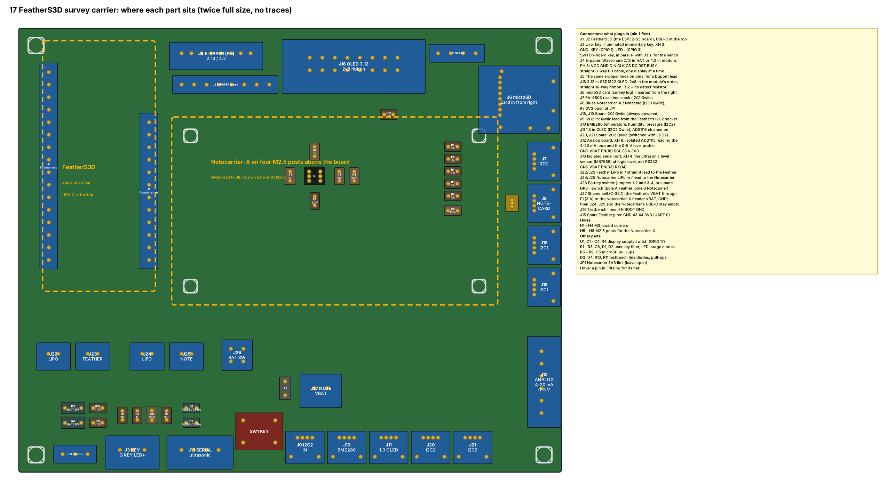
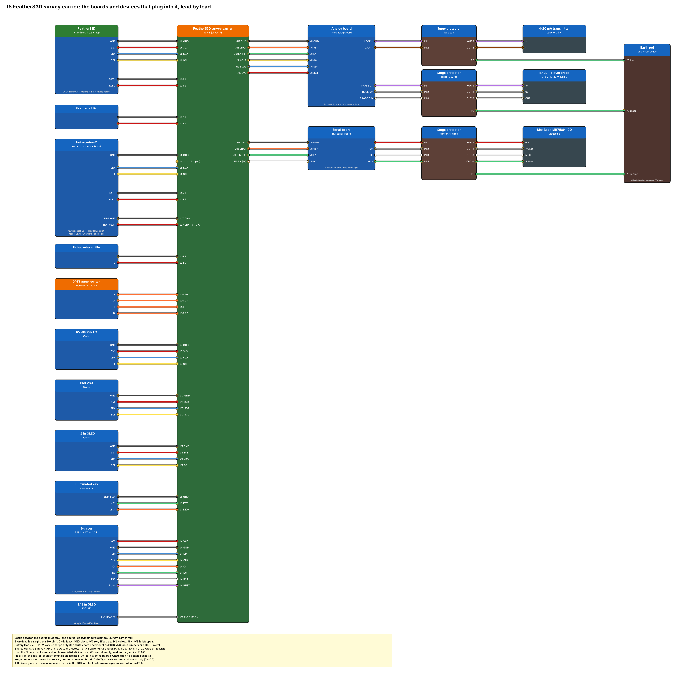

# FeatherS3D survey carrier board

A two-layer carrier PCB that replaces the hand wiring of the FeatherS3D site
survey (`commissioning/fs3-survey`) and of the §40 build's add-ons. The
FeatherS3D plugs into two socket strips, and the Notecarrier-X stands on four
posts above the board. The key, the display supply, the displays, the microSD,
both I2C buses, the add-on boards and the bench lines then reach the Feather
through keyed connectors. The pins are FSD §40.2's
([feathers3-build.md](feathers3-build.md) gives the header order). The design
files are in [`hardware/fs3-survey-carrier/`](../../../hardware/fs3-survey-carrier/), and
[`hardware/README.md`](../../../hardware/README.md) lists the steps to produce the boards.

Wiring sheet 17 shows where each part sits, with the Feather and the
Notecarrier-X drawn as outlines over the board. Its
[`.fzz`](wiring/wiring-17-fs3-carrier.fzz) opens in Fritzing, where hovering
over a pin shows its net.



## The board

110 × 90 mm, two layers, 1.6 mm FR-4, four M3 holes at the corners. All parts
are on the top. The Feather sits at the left with its USB-C at the top edge, so
the cable and the board's own STEMMA QT sockets, RST and BOOT buttons stay
reachable. Only tracks and the head of the top-left screw lie under it. B.Cu is a ground pour, with tracks
only where a crossing needs one. F.Cu carries the tracks and its own ground
pour, and a via beside each surface-mount ground pad ties the two pours
together. Tracks are 0.25 mm and power tracks 0.5 mm, with 0.2 mm clearance
and 0.6 mm vias (0.8 mm on power).

| Ref | Connector | Pins, pin 1 first | To |
|-----|-----------|-------------------|----|
| J1, J2 | 1 × 16 and 1 × 12 sockets, 2.54 mm | The Feather's long and short headers | The FeatherS3D |
| J3 | JST XH, 3 way | GND, KEY, LED+ | The off-board illuminated key (key to GND, its LED's cathode to GND) |
| SW1 | 6 mm tactile key | In parallel with the off-board key | Testing without the key |
| J4 / J5 | JST PH 8 way / 1 × 8 pins, in parallel | VCC, GND, DIN, CLK, CS, DC, RST, BUSY | Waveshare 2.13" e-Paper HAT V3 or 4.2" e-Paper Module V2, one at a time. J4 is the display's own PH 2.0 socket in the display's order, so a straight 8-way PH 2.0 cable, female at both ends, joins them pin 1 to pin 1 |
| J16 | 2 × 8 shrouded box header, 2.54 mm | The module's own order ([ws-displays.md](ws-displays.md#header)): GND, VCC (switched), NC, SCLK, SDIN, D2, D3 – D7, E/RD, R/W, DC, RES (GPIO 12), CS (GPIO 11) | The 3.12" SSD1322 OLED (§40.2), through a straight 16-way IDC ribbon, female at both ends. The board ties D3 – D7, E/RD and R/W to GND and leaves D2 open. R12 (10 kΩ) runs from CS to pin 3 for detection (FR-35.25) |
| J6 | microSD, Molex 104031-0811 | SPI mode | The card, inserted from the right edge |
| J7 | Qwiic (JST SH 4) | GND, 3V3, SDA, SCL | I2C1: the RV-8803 |
| J8 + JP1 | Qwiic | GND, (3V3 through JP1, open), SDA, SCL | I2C1: the Notecarrier-X, its 3.3 V unconnected (§33.2) |
| J9 | Qwiic | GND, 3V3 (LDO2), SDA, SCL | I2C2 in: a Qwiic cable from the Feather's I2C2 socket |
| J10, J11 | Qwiic | GND, 3V3 (LDO2), SDA, SCL | I2C2 out: the BME280 and the 1.3" OLED (and the ADS1115 chained on) |
| J18, J19 | Qwiic | GND, 3V3, SDA, SCL | I2C1 spares |
| J20, J21 | Qwiic | GND, 3V3 (LDO2), SDA, SCL | I2C2 spares |
| J12 | JST XH, 6 way | GND, VBAT, EN (GPIO 18), SCL2, SDA2, 3V3 (LDO2) | The analog board (§40.2) |
| J13 | JST XH, 4 way | GND, VBAT, EN (GPIO 33), RX (GPIO 14) | The isolated serial port (§40.2) |
| J22 / J23 | JST PH 2 way, each | Battery in / battery out | The Feather's LiPo plugs into J22; a straight PH lead runs from J23 to the Feather's battery socket |
| J24 / J25 | JST PH 2 way, each | Battery in / battery out | The same for the Notecarrier-X's LiPo |
| J26 | 2 × 2 pins, 2.54 mm | Pole A: 1 – 2 (Feather), pole B: 3 – 4 (Notecarrier) | Two jumpers, or a lead to a panel DPST switch |
| J27 | JST XH, 2 way | GND, VBAT through F1 (3 A) | The shared cell (C-33.1): a lead to the Notecarrier-X header's VBAT and GND |
| J14 | 1 × 3 pins | EN, BOOT, GND | The testbench's slot lines |
| J15 | 1 × 4 pins | GND, GPIO 43, 44, 3V3 | The header's free pins (UART 0); GPIO 11 and 12 belong to the OLED |

**Notecarrier-X.** Four M2.5 holes (H5 – H8) take posts for the
Notecarrier-X above the middle of the board. They match Blues' v1.2
dimensional drawing: the board is 66.11 × 38.10 mm, and its holes are
58.49 × 30.48 mm apart, 3.81 mm in from each edge. The silkscreen outlines it.
Its Qwiic lead runs to J8. Its USB-C and LiPo socket are on its short ends, and
the antenna leads leave from its top face. Only passives lie under it, so any
post of 10 mm or more clears them; Blues recommends nylon screws for its
satellite carriers.

Each add-on connector has a different pin count, so a cable fits only its own
socket. GPIO 15 and 16 (I2C2) are not on the Feather's header, so the switched
bus comes in on J9 from the Feather's own I2C2 socket and fans out from there.
The carrier adds no I2C pull-ups: each bus keeps the one set it has today.

## Circuits

**Display supply.** A TI TPS22917 load switch (U1) takes LDO1's 3.3 V and
feeds VSW: the e-paper, the microSD and their pull-ups. It replaces the
Pololu #2808 and keeps its behaviour, so the survey firmware does not change.
GPIO 17 drives ON high or low for 10 ms and then floats. R4 (2.2 MΩ) from VSW
back to ON then holds the state, the way the Pololu's latch did. When the
switch is on, VSW holds ON high: the TPS22917 removes its ON pull-down above
1 V and leaks at most 10 nA there. When it is off, the switch's 750 kΩ smart
pull-down and the discharge of VSW (QOD tied to VOUT, 150 Ω) hold ON low. At
power-up VSW is 0 V, so the displays start off. C2 (1 nF, CT to VIN) gives
about 4 ms turn-on, within FR-40.8's 100 ms wait. TI gives the switch's off
current as 10 nA typical, the same as the Pololu's 0.01 µA. The board
only adds currents that flow while something is pressed or driven.

**Key.** As the Waveshare build's key (§35.2): a 10 kΩ pull-up to 3V3 on
GPIO 1, then 1 kΩ in series and 100 nF to GND at the board end, and a TVS diode
(D1) on the cable side. The LED runs from GPIO 3 through 330 Ω, with its own
TVS diode (D2). The cable carries three wires: GND, KEY and LED+.

**microSD.** It runs in SPI mode on the e-paper's SPI2 (SCK 36, MOSI 35),
with MISO on GPIO 37 and CS on GPIO 38. It has 10 kΩ pull-ups to VSW on CS,
MISO, MOSI, DAT1 and DAT2, as on the Adafruit #4682, so a switched-off card
draws nothing. Card detect is not wired: an empty slot is a mount that fails.

**Battery switch.** Each LiPo can pass through the carrier on its way to its
board: pin 1 of each battery socket runs straight through, and pin 2 runs
through one pole of J26. Nothing on the switch path touches the board's ground,
so it works whichever pin of a battery's plug is positive. With jumpers on 1 – 2
and 3 – 4 both batteries are always connected. A panel DPST switch on J26 turns
both off together. A battery can also plug straight into its own board, which
bypasses the switch. The tracks are 0.5 mm wide, enough for the Notecard's
transmit bursts.

**Shared cell.** J27 serves C-33.1's single cell: the Feather's VBAT (its
header's BAT pin) through F1, a 3 A fast fuse at the board end, to a lead of at
most 150 mm and at least 22 AWG on the Notecarrier-X header's VBAT and GND. The
cell is then the Feather's alone, in J22 behind pole A of J26 or in the
Feather's own socket, and the Feather alone charges it. J24, J25, the
Notecarrier's LiPo socket and its USB-C carry nothing, so two cells or two
chargers never meet; one USB-C at the enclosure wall to the Feather charges the
cell. With J27 unused, each board keeps its own cell (C-40.11) and one 5 V
source of at least 3 A feeds both USB-C sockets through a power-only Y cable.
Check the lead's polarity with a meter before the Notecarrier is fitted.

**Room at the Notecarrier-X's ends.** Its USB-C, LiPo socket and ESLOV
socket sit on its short ends, over x 31 and x 97 on the posts. The shared cell
needs none of them: only the two u.FL antenna leads and J27's lead to the
header. For two cells on the Y cable, the right end has 13 mm to the board
edge for the LiPo plug and its bend, and the left end a USB-C plug crosses the
Feather: use a right-angle USB-C plug there.

**Bench lines.** These keep sheet 16's two Schottky diodes (BAT43W, cathode at
the bench), so the bench can only pull RST or GPIO 0 low. The carrier adds
4.7 kΩ pull-ups (R10, R11) on RST and GPIO 0, which hold both near 3.0 V
against a Pi pin left with its default 50 kΩ pull-down. A slot wired to this
board no longer needs `gpio=…=ip,pu` in the Pi's `config.txt`.

## Why RST failed with the bench lead fitted

The Feather's RST button shorts EN straight to ground, and nothing on the
bench line can stop that. So the press does reset the chip. What the chip does
next depends on GPIO 0, which it samples as EN rises. If GPIO 0 is low then,
the chip starts the ROM's download mode, not the app, and looks dead. The
bench's BOOT line reaches GPIO 0 through its diode. The chip's own pull-up on
GPIO 0 is weak (about 45 kΩ), so a Pi pin with its default 50 kΩ pull-down,
or one left driven low after a flash or a recover, holds GPIO 0 low enough.
The bench's own reset works because it sets BOOT high before it releases EN.

This is the likely cause, not a proven one. To check it on SLOT11, press RST
and watch the serial monitor for the ROM's `waiting for download` banner.
The board's R11 removes the cause: GPIO 0 stays high unless the bench
actively drives it low.

## Add-on boards

Two boards plug into the carrier with straight JST XH leads. Their designs are in
[`hardware/fs3-analog-board/`](../../../hardware/fs3-analog-board/) and
[`hardware/fs3-serial-board/`](../../../hardware/fs3-serial-board/), made the same
way as the carrier. Sheet 18 shows every lead between the boards, the devices and
the field wiring:



Its [`.fzz`](wiring/wiring-18-fs3-boards.fzz) opens in Fritzing.
Sheets [19](wiring/wiring-19-fs3-analog.png) ([.fzz](wiring/wiring-19-fs3-analog.fzz)) and
[20](wiring/wiring-20-fs3-serial.png) ([.fzz](wiring/wiring-20-fs3-serial.fzz)) show where each
part sits on the analog and serial boards, as sheet 17 does for the carrier.

Both boards share a front end. The enable line has a 100 kΩ pull-down, so the board is
off through sleep and reset. It drives a P-MOSFET load switch from VBAT (Q1 AO3401A,
Q2 MMBT3904, a 47 nF soft start), as on the loop circuit of §29. An MT3608 boost then
feeds an isolated 2 W DC-DC (XP Power IH, 3 kVDC). The field side is on the right, past
a 5 mm gap with no copper on either layer. Only the DC-DC and a TI ISO1642 isolator
(5 kVrms) cross the gap. Each side has its own ground pour: GND on the left, GNDI on the
right.

**Analog board** (74 × 54 mm, carrier J12; FSD §29, §40.2, FR-40.9).

- **24 V.** The boost makes 5.1 V for an IH0512S-H. Its +12 V and −12 V
  outputs together give 24 V at up to 83 mA, with −12 V as the field side's 0 V.
- **ADC.** An ADS1115 at 0x49 runs from an LM317L at 3.25 V. It talks to I2C2
  through the ISO1642, whose side 1 runs from LDO2.
- **4-20 mA loop.** It is powered through a DN2540 current limiter (47 Ω and the
  RV1 trimmer) and runs into the 100 Ω 0.1 % shunt across A0 – A1. An SMBJ28CA
  TVS sits across its terminal.
- **0 – 5 V probe.** Its 24 V comes through a second limiter (RV2). Its signal
  reaches A2 through a 15 kΩ / 10 kΩ 0.1 % divider with 100 nF. TVS diodes
  protect both lines.
- **Supply budget (C-40.10).** A shorted loop draws 30 mA, the regulator 11 mA and
  the probe at most 25 mA. That totals 66 mA, which fits 83 mA with 20 % to spare.
- **Trimming.** Trim RV1 to 25 – 30 mA and RV2 to about 25 mA, each with its
  terminal shorted through an ammeter.

**Serial board** (63 × 54 mm, carrier J13; FSD §40.2, FR-40.12, C-40.4).

- **5 V supply.** The boost is set to 4.7 V (R6 680 kΩ). It feeds an IH0505S-H,
  whose +5 V output powers the MB7569 at about 5 V. The ISO1642 and the
  sensor's 5.5 V limit stay safe at light load.
- **Serial line.** The sensor's TX passes a TVS diode and 1 kΩ to the
  isolator's INB, with 100 kΩ holding INB low. OUTB on the board side drives
  GPIO 14, which the firmware inverts. GPIO 33 powers the isolator's board side
  as well as enabling the supply.
- **Ranging.** The ranging pin is tied high through 1 kΩ.
- **Signal levels.** This port carries logic levels only. A true RS232
  instrument still needs §30's MAX3232 board.

Both boards keep C-40.7's surge protectors at the enclosure wall, not on the board.
Their own TVS diodes only clamp what passes the protectors.

## Before ordering

These were not checked against the physical parts:

1. **The Notecarrier's holes.** Check that a Notecarrier-X v1.3 has the same
   holes as the v1.2 drawing, and that M2.5 posts fit them.
2. **The Feather's footprint.** Print `fab/assembly.pdf` at 100 % and lay a
   FeatherS3D on it. The long header's pin 1 (RST) is at the USB-C end, and
   the short header's BAT pin is level with the long header's fifth pin
   (GPIO 17).
3. **The display cables.** The e-paper's PH cable must be a same-direction
   one (pin 1 to pin 1), not a reversed one. The OLED's ribbon is a standard
   straight IDC cable. Check that the OLED module's pin 3 is unconnected, then
   bridge its pins 1 and 3 (the first two pins of the same row) on its back, so
   that R12 sees ground only when the OLED is plugged in.
4. **The Qwiic pinout.** Pin 1 is GND and pin 4 is SCL, as on SparkFun and
   Adafruit boards.
5. **§40.2.** The FSD still names the Pololu #2808 as the display supply. If
   this board is adopted, the user changes that row.
6. **The add-on boards' isolation.** XP Power rates the IH -H models at
   3 kVDC; check the test duration against C-40.6's 1 minute. Also check the
   IH0512S-H's pins against its drawing (1 +Vin, 2 −Vin, 4 −Vout, 5 0V,
   6 +Vout, as in KiCad's library).
7. **The terminal order.** Each field terminal is numbered from the bottom
   of the board: the silk says which wire goes where.

## Ordering and assembly

Upload `fab/fs3-survey-carrier-gerbers.zip` to any board house and order 2
layers, 1.6 mm, HASL or ENIG, with the default 0.2 mm (8 mil) rules. The
parts are 0805 passives, SOD-123 and SOD-323 diodes, one SOT-23-6, the
microSD socket and the Qwiic sockets, all hand-solderable.
`fab/bom.csv` lists them, and `fab/positions.csv` gives the placement
(origin at the bottom-left corner) for an assembly service; `fab/bom-jlc.csv`
and `fab/cpl-jlc.csv` are the surface-mount parts in JLCPCB's columns
([hardware/README.md](../../../hardware/README.md) says how to use them). Fit the
through-hole connectors last. Leave JP1 open.

After assembly, and before the Feather goes in, check the following:

- No short between 3V3, VSW, VBAT and GND.
- VSW reads 0 V with 3V3 applied at J15 pin 4.
- Pulling J1 pin 5 (GPIO 17) to 3V3 for a moment turns VSW on, and it stays
  on. Pulling the pin to GND turns VSW off, and it stays off.

## Regenerating

Everything is generated from [`netlist.py`](../../../hardware/fs3-survey-carrier/netlist.py),
which lists each part's place and pin nets. Edit that file, not the KiCad
files. The scripts need KiCad 7 (`kicad-cli` and the `pcbnew` Python module)
and its symbol and footprint libraries (`apt install kicad kicad-symbols
kicad-footprints`).

The scripts in [`hardware/pcbgen/`](../../../hardware/pcbgen/) serve all three
boards. Each runs from a board's directory and reads its `netlist.py`, which also
holds the board's own choices (size, silk, ground pours, isolation gap).

```bash
cd hardware/fs3-survey-carrier     # or fs3-analog-board, fs3-serial-board
python3 ../pcbgen/make_sch.py      # the schematic
python3 ../pcbgen/make_pcb.py      # placement, routing (route.py), ground pours
python3 ../pcbgen/check.py --pcb   # schematic and board match netlist.py; KiCad DRC: no errors
python3 ../pcbgen/make_fab.py      # fab/: Gerbers, drill, BOM, positions, PDFs, pictures
python3 ../pcbgen/make_placement.py  # wiring sheet 17, 19 or 20: the part placement
python3 make_connections.py        # carrier only: wiring sheet 18, the leads between boards
```

`route.py` is a small maze router: it routes each net on a 0.127 mm grid and
keeps every track and via clear by the 0.2 mm rule. Its tracks are correct
but not pretty. Tidy them in KiCad if the board is to be shown. Run
`check.py --pcb` again after any hand edit.
