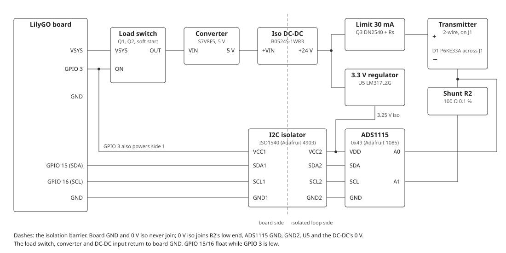
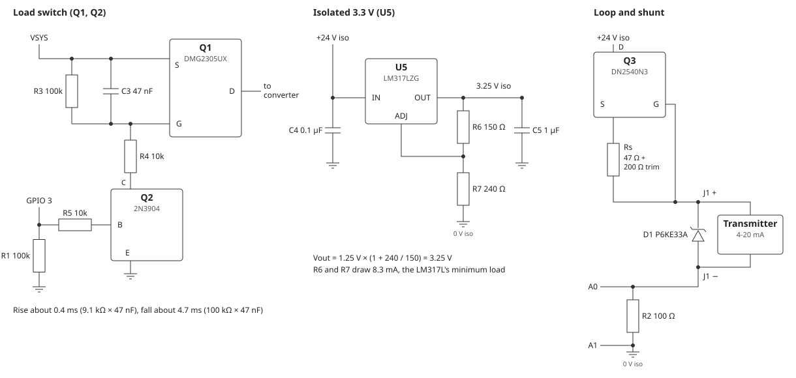

# 4-20 mA loop circuit

The hardware for the 4-20 mA loop input of FSD §29. It powers and reads one 2-wire
transmitter through an isolated loop side. The firmware is on main, but this circuit
has not been built yet. Every part is through-hole or a breakout with 0.1" pins, so
it builds on a breadboard or perfboard. Fritzing
[sheet 2](wiring/wiring-2-loop-4-20ma.png) shows the wiring. Figures come from the
datasheets listed under Sources; check them against current ones.

## Parts

| Ref | Function (FSD §29.1) | Part | Notes |
|-----|----------------------|------|-------|
| Q1, Q2 | Load switch with a controlled rise time | Diodes DMG2305UX P-MOSFET (SOT-23 on any SOT-23-to-DIP adapter, such as SparkFun BOB-00717; −20 V, VGS(th) −0.5 to −0.9 V, 100 mΩ max at −2.5 V; AO3401A and Si2301CDS are other sources) and a 2N3904 (TO-92) | See [Load switch](#load-switch) |
| U3 | Wide-input converter to 5 V | Pololu S7V8F5 (2.7 – 11.8 V in, 5 V out) | Leave SHDN open: its 100 kΩ pull-up to VIN would fight R1, so Q1 does the switching |
| U4 | Isolated 1 W DC-DC, 24 V | Murata NME0524SC, SIP-4 (4.5 – 5.5 V in, 24 V at 4.2 – 42 mA, 1000 VDC; pins 1 – 4 −VIN, +VIN, −VOUT, +VOUT) | Specified over 10 – 100 % load; U5 alone keeps it above 10 % |
| U5 | Isolated 3.3 V regulator, at least 40 V across it | onsemi LM317LZG (TO-92, Pb-free, 40 V in – out; pins 1 – 3 ADJ, OUT, IN) | See [Isolated 3.3 V](#isolated-33-v) |
| Q3 | Loop current limit, about 30 mA | Microchip DN2540N3 depletion MOSFET (TO-92) | See [Loop and shunt](#loop-and-shunt) |
| D1 | TVS across the terminals | P6KE33A (DO-15, 28.2 V stand-off) | Cathode (band) to J1 + |
| U7 | Loop ADC | Adafruit 1085 ADS1115 breakout | ADDR to VDD for 0x49 |
| U8 | I2C isolator | Adafruit 4903 ISO1540 breakout | 10 kΩ pull-ups on each side to that side's VCC |
| R2 | Shunt | TE YR1B100RCC: 100 Ω, 0.1 %, 15 ppm/°C, 0.25 W axial | 40 mW at 20 mA |
| J1 | Transmitter terminal | 2-pin screw terminal, 5.08 mm | |
| C | Decoupling | 100 nF ceramic at U7 and at each side of U8; 10 µF electrolytic at U3 out | Radial, 0.1" pitch |

## Connections

| Connection | Parts | Purpose |
|------------|-------|---------|
| VSYS → Q1 source; Q1 drain → U3 VIN | Q1, Q2, R1, R3 – R5, C3 | Battery/system rail to the converter, switched by GPIO 3 with a soft start |
| GPIO 3 → R5 → Q2 base; GPIO 3 → U8 VCC1 | R1 100 kΩ GPIO 3 to GND | One pin turns the supply on and powers the isolator's board side; R1 holds both off through sleep and reset |
| U3 5 V → U4 +VIN; U3, U4 −VIN, Q2 emitter → GND | 10 µF at U3 out | The converter feeds the isolated DC-DC |
| U4 +VO → Q3 drain and U5 IN; U4 0V → 0 V iso | | The isolated 24 V and its 0 V, which never touches board GND |
| Q3 → Rs → J1 +; Q3 gate → J1 + | Rs 47 Ω + 200 Ω trimmer | Limits the loop to about 30 mA |
| J1 − → R2 → 0 V iso; J1 − → A0; 0 V iso → A1 | R2 | The loop current makes 0.4 – 2.0 V across R2, read as A0 – A1 |
| D1 across J1 | | Clamps transients on the transmitter cable |
| U5 OUT → U7 VDD and U8 VCC2 | R6, R7, C4, C5 | The isolated 3.25 V |
| U7 SDA/SCL ↔ U8 SDA2/SCL2; U8 SDA1/SCL1 ↔ GPIO 15/16; U8 GND1 → GND | | The loop's own I2C bus, controller 1, 100 kHz |

## Circuit details

### Load switch

| Ref | Part | Note |
|-----|------|------|
| R3 | 100 kΩ, gate to source | Holds Q1 off |
| C3 | 47 nF ceramic, gate to source | Sets the rise and fall times |
| R4 | 10 kΩ, gate to Q2 collector | Pulls the gate to about 0.09 × VSYS when Q2 is on |
| R5 | 10 kΩ, GPIO 3 to Q2 base | About 0.26 mA of base current; Q2 sinks about 0.4 mA |
| R1 | 100 kΩ, GPIO 3 to GND | Off through sleep and reset |

With Q2 on, VGS is about −0.91 × VSYS: −2.7 V on a 3.0 V battery, where the
DMG2305UX is under 100 mΩ: about 35 mV dropped at 0.35 A. No through-hole P-MOSFET in
production specifies RDS(on) at this gate drive, so Q1 is the one part on an
adapter. All three sources share the SOT-23 pinout: pin 1 G, 2 S, 3 D; wire by the
adapter's silkscreen. C3 sets the rise time, so any of them gives the same soft start.
The gate settles with a time constant of 9.1 kΩ × 47 nF, about
0.4 ms, so the converter and DC-DC capacitors charge without a step on the battery. It
turns off with 100 kΩ × 47 nF, about 4.7 ms, well inside the 50 ms margin of NFR-29.2.

### Isolated 3.3 V

| Ref | Part | Note |
|-----|------|------|
| R6 | 150 Ω 1 %, OUT to ADJ | |
| R7 | 240 Ω 1 %, ADJ to 0 V iso | VOUT = 1.25 V × (1 + 240 / 150) = 3.25 V |
| C4 | 100 nF, 50 V, IN to 0 V iso | |
| C5 | 1 µF, OUT to 0 V iso | |

R6 and R7 draw 8.3 mA. With the ADS1115 (about 0.2 mA) and the ISO1540's side 2
(about 2 – 3 mA), the load is about 11 mA, above the LM317L's 10 mA worst-case
minimum. Dropping about 21 V, U5 dissipates about 0.25 W, only for the 300 ms of a
reading.

### Loop and shunt

Q3 and Rs form a current limiter: the gate sits at the far end of Rs, so the current
settles where the drop across Rs equals −VGS. The DN2540's VGS(off)
spreads from −1.5 to −3.5 V, so Rs for 30 mA lies between about 50 and 117 Ω. Fit
47 Ω plus a 200 Ω multi-turn trimmer, then trim on the bench: short J1 through an
ammeter and set 25 – 30 mA. Below 21 mA the limiter must not act.

| Loop current | Across R2 | Note |
|--------------|-----------|------|
| 4 mA | 0.400 V | |
| 20 mA | 2.000 V | |
| 21.0 mA | 2.100 V | NAMUR fault above this (FR-29.4) |
| 30 mA (shorted loop) | 3.0 V | Below U7's input limit of VDD + 0.3 V, about 3.55 V |

The ADS1115 resolves 125 µV at ±4.096 V, which is 1.25 µA through R2.

## Budgets

| Budget | Figure | Note |
|--------|--------|------|
| Loop voltage | 24 V − about 3 V (Q3, Rs) − 2.1 V (R2 at 21 mA) ≈ 19 V | Left for the transmitter; most need 10 – 12 V |
| 24 V current | 30 mA (shorted loop) + 11 mA (U5) = 41 mA | U4 is rated 42 mA |
| U4 output voltage | Load regulation 7.5 % max over 10 – 100 % load: about 25.8 V at most | Below D1's 28.2 V stand-off |
| Q3 in a short | 30 mA × about 21 V ≈ 0.6 W | Only for the 300 ms of a reading |
| GPIO 3 load | Q2 base 0.26 mA + R1 0.03 mA + U8 side 1 about 3 mA + its LED | Well within a GPIO's drive; U8 needs at least 3.0 V on VCC1 |
| Battery during a reading | About 0.25 – 0.35 A for about 0.3 s | An estimate from typical efficiencies, not measured |
| Battery in sleep | None from the loop hardware | Q1 off, U8 unpowered, GPIO 15/16 floating (C-29.2) |
| Accuracy | R2 0.1 % + ADS1115 gain 0.15 % worst case | Can exceed NFR-29.1 at 20 mA; typical parts pass (R-34) |

## Reading

What `components/loop/loop.c` does, after each BME280 reading:

1. Set GPIO 3 high: Q1 turns on, and U8's side 1 is powered.
2. Wait `loop_warm_ms`, 300 ms by default.
3. Open I2C controller 1 on GPIO 15/16 and take the mean of 4 single-shot conversions
   of A0 – A1 at ±4.096 V and 128 SPS.
4. Close the bus and let GPIO 15/16 float, without pulls.
5. Set GPIO 3 low.

## To check before wiring

1. **VSYS.** LilyGO's pinout picture labels these pins VBUS, but the silkscreen says
   VSYS. With USB unplugged, check with a meter that they carry the battery voltage.
2. **GPIO 15/16.** They are the ESP32-S3's 32 kHz crystal pins, which this board does
   not use. Check that the header brings them out where the sheet shows them.
3. **U8's side 1 from GPIO 3.** Measure VCC1 with the loop on: it must stay above
   3.0 V with the LED and pull-ups.
4. **U3's SHDN.** With only VIN and GND connected, SHDN should sit high. It must stay
   unconnected.
5. **The limiter.** Trim Rs before connecting a transmitter.
6. **U4 at light load.** Measure +VO with J1 open: it must stay below 28.2 V.
7. **The transmitter.** Compare its minimum supply voltage with the loop voltage
   budget.

## Bring-up

Run [`commissioning/loop-probe`](../../../commissioning/loop-probe/main/main.c) before
the first bench test. Every 2 s it:

- scans the main bus (0x76 must answer) and reads GPIO 15/16 with the loop off;
- turns the loop on, scans the loop bus (0x49 must answer), and prints the current
  and how long the supply was on.

With a 4-20 mA calibrator on J1 it gives the raw figures for NFR-29.1. With J1
shorted, it shows the current the limiter holds (C-29.3).

## Installation

Keep the loop cable away from mains wiring, and use a twisted pair, shielded for long
runs. Earth the shield at one end only. The loop side floats, so a transmitter with
an earthed body does not make a ground loop through the board. Check C-29.1 with an
ohmmeter between J1 and USB ground: above 100 MΩ.

## Sources

- [DMG2305UX datasheet](https://static.chipdip.ru/lib/159/DOC013159942.pdf)
- [SparkFun SOT23 to DIP Adapter](https://www.sparkfun.com/sparkfun-sot23-to-dip-adapter.html)
- [AO3401A datasheet](https://static.datasheets.com/doc/6022655-alpha-omega-ao3401a-ds.pdf)
- [Si2301CDS datasheet](https://static.chipdip.ru/lib/667/DOC012667805.pdf)
- [Pololu S7V8F5](https://www.pololu.com/product/2123)
- [Murata NME datasheet](https://docs.rs-online.com/c317/0900766b8167506a.pdf)
- [onsemi LM317L datasheet](https://datasheet.ciiva.com/14562/70099595-14562037.pdf)
- [ISO1540 datasheet](https://proto-pic.co.uk/content/iso1540.pdf)
- [Adafruit ISO1540 guide](https://learn.adafruit.com/adafruit-iso1540-bidirectional-i2c-isolator)
- [TE YR1B100RCC](https://octopart.com/part/te-connectivity/YR1B100RCC)
