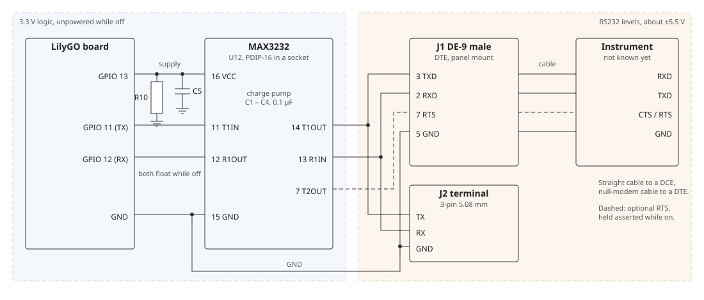
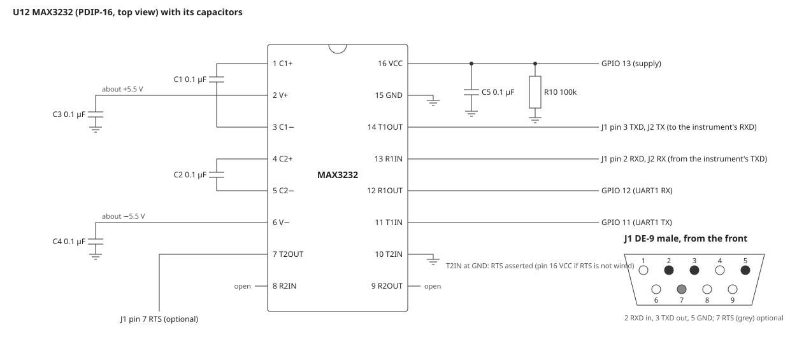

# RS232 instrument circuit

The hardware for the RS232 instrument input of FSD §30. It connects one instrument
to UART1 through a MAX3232 transceiver. Neither the firmware nor this circuit is
built yet. Every part is through-hole or panel-mount, so it builds on a breadboard
or perfboard. Fritzing [sheet 4](wiring/wiring-4-rs232.png) shows the wiring.
Figures come from the datasheets listed under Sources; check them against current
ones.

GPIO 13 is the transceiver's supply. While the port is off, the chip is unpowered
and GPIO 11 and 12 float, so the circuit draws nothing from the board (C-30.2).
The loop isolator is powered from GPIO 3 in the same way.

## Parts

| Ref | Function (FSD §30.1) | Part | Notes |
|-----|----------------------|------|-------|
| U12 | RS232 transceiver | Analog Devices MAX3232ECPE+, PDIP-16 (3.0 – 5.5 V, two drivers and two receivers, ±15 kV ESD on the RS232 pins) | MAX3232EPE+, MAX3232EEPE+ (−40 °C) and MAX3232CPE+ (±2 kV ESD only) fit the same socket |
| X1 | Socket | 16-pin DIP socket, 0.3" | |
| C1 – C4 | Charge pump | 0.1 µF ceramic, 50 V, radial 0.1" | The datasheet value for VCC 3.0 – 3.6 V |
| C5 | Decoupling | 0.1 µF ceramic at pin 16 | No bulk capacitor, so GPIO 13 sees no large inrush |
| R10 | Off through sleep and reset | 100 kΩ, GPIO 13 to GND | |
| J1 | Instrument connector | DE-9 male, panel mount, solder cups, wired with short leads | A right-angle PCB DE-9 has its pins at 2.77 mm, which does not fit 0.1" perfboard |
| J2 | Bare-wire alternative | 3-pin screw terminal, 5.08 mm (TX, RX, GND) | Same pitch as the loop's J1 |

## Connections

| Connection | Parts | Purpose |
|------------|-------|---------|
| GPIO 13 → U12 pin 16 VCC | C5, R10 to GND | The supply, switched by the firmware; R10 holds it off through sleep and reset |
| GPIO 11 (UART1 TX) → pin 11 T1IN; pin 12 R1OUT → GPIO 12 (UART1 RX) | | Logic side at 3.3 V; both pins float while the port is off |
| Pin 14 T1OUT → J1 pin 3 TXD and J2 TX | | To the instrument's RXD |
| J1 pin 2 RXD and J2 RX → pin 13 R1IN | | From the instrument's TXD |
| Pin 15 GND → board GND, J1 pin 5, J2 GND | | Signal ground |
| Pin 7 T2OUT → J1 pin 7 RTS; pin 10 T2IN → GND | | Optional RTS, held asserted while the port is powered |
| Pins 1 – 6 | C1 – C4 | The charge pump, see [Charge pump](#charge-pump) |
| Pin 8 R2IN, pin 9 R2OUT | | Open; R2IN has an internal 5 kΩ pull-down |

J1 is wired as a DTE, like a PC: a straight cable goes to a DCE instrument and a
null-modem cable to a DTE one.

## Circuit details

### Charge pump

| Ref | Between | Note |
|-----|---------|------|
| C1 | Pin 1 C1+ and pin 3 C1− | Flying capacitor of the doubler |
| C2 | Pin 4 C2+ and pin 5 C2− | Flying capacitor of the inverter |
| C3 | Pin 2 V+ and GND | Holds about +5.5 V |
| C4 | Pin 6 V− and GND | Holds about −5.5 V |
| C5 | Pin 16 VCC and GND | Decoupling, close to the socket |

C3 can go to VCC instead of GND, as the datasheet allows; GND keeps it off
the switched supply. Keep all five leads short: the pump switches at a few hundred
kHz. The pump needs about 10 ms [proposed] after power-on to reach its levels,
which is the settle of §30.1.

### Supply from GPIO 13

The MAX3232E draws 0.3 mA typical, 1 mA max, with no RS232 load, and a few mA more
for each driver into an instrument's 3 – 7 kΩ input. GPIO 13 supplies that
directly, as the loop's GPIO 3 supplies the isolator's side 1. With GPIO 13 low and
R10 pulling it down, VCC is 0 V. GPIO 11 and 12 must then float, not drive high, or
TX would power the chip through T1IN's input protection (check 2).

### RTS

Some instruments only answer with RTS (their CTS) asserted. The second driver holds
it: T2IN at GND makes T2OUT high, the RS232 "asserted" level, for as long as the
port is powered. With RTS not wired, tie T2IN to VCC (pin 16) instead, so T2OUT
sits low and draws nothing extra. No GPIO controls it.

### DE-9

J1 is male, like a PC's serial port. From the front, pins 1 – 5 run left to right on
the wide row and 6 – 9 on the narrow one. Only pins 2, 3, 5 and optionally 7 are
used; leave the others unconnected, and do not tie DTR, DSR or DCD together.

## Budgets

| Budget | Figure | Note |
|--------|--------|------|
| GPIO 13 load, idle | 0.3 mA typical, 1 mA max (MAX3232E with no RS232 load) | |
| GPIO 13 load, driving | About 3 mA with T1OUT into a 3 – 7 kΩ instrument input, about 6 mA with RTS also driven | An estimate from the datasheet's charge-pump doubler, not measured |
| VCC at the chip | At least about 3.1 V at 6 mA | Above the MAX3232's 3.0 V minimum; measure it on the bench (check 3) |
| Settle after power-on | 10 ms [proposed] before the first byte | Lets V+ and V− reach about ±5.5 V |
| Port on per reading | `rs_timeout_ms` + 50 ms at most (NFR-30.1) | 1.05 s at the default timeout |
| Sleep | None from the RS232 hardware | Chip unpowered, GPIO 11/12 floating (C-30.2) |

## Reading

What the RS232 component does after each BME280 reading, with `rs` not `off`
(FR-30.2):

1. Set GPIO 13 high, which powers the MAX3232.
2. Wait 10 ms.
3. Install UART1 on GPIO 11/12 at `rs_baud` and `rs_format`, then poll or listen
   (FR-30.3, FR-30.4).
4. Remove UART1 and leave GPIO 11 and 12 as inputs without pulls.
5. Set GPIO 13 low.

## To check before wiring

1. **Header pins.** LilyGO's picture puts GPIO 11, 12 and 13 on the left header,
   between GPIO 10 and 14. The loopback program under Bring-up proves them first.
2. **No back-powering.** With the port off and the chip fitted, pin 16 should
   read below 0.3 V. If it reads higher, TX is not floating.
3. **Supply under load.** With an instrument (or a 3 kΩ load from T1OUT to GND)
   and the port on, pin 16 should read at least 3.0 V. If it does not, move U12's
   supply to 3V3 through a load switch, or fit the MAX3222ECPN+ (PDIP-18), whose
   SHDN pin GPIO 13 can drive (about 1 µA in shutdown).
4. **Levels.** With the port on and idle, J1 pin 3 should sit at about −5.5 V.
   During a poll it should swing to about +5.5 V.
5. **The instrument.** Find whether it is a DTE or a DCE, its baud and format, and
   whether it needs RTS, from its manual, before choosing the cable.

## Bring-up

A commissioning program, `commissioning/rs232-probe` (C-30.1, not written yet),
runs before the first bench test, in two stages:

- **Without the transceiver.** GPIO 11 jumpered to GPIO 12. It toggles GPIO 13,
  then sends and reads back 64 bytes at every baud and format of §30.1. Every byte
  must come back, and GPIO 13 must follow its command on a meter.
- **With the transceiver.** J1 pins 2 and 3 joined by a loopback plug. The same
  test runs through the MAX3232, with the 10 ms settle, and prints how long GPIO 13
  was high.

The bench tier then uses the testbench host's USB-RS232 adapter on J1, running a
scripted instrument (FSD §30 test table).

## Installation

Use a shielded cable for runs longer than a few metres, with the shield earthed at
the instrument end only, not on pin 5. RS232 is specified to 15 m at 19 200 baud
(2500 pF); at 9600 baud a low-capacitance cable runs further. The port is not
isolated: pin 5 is the board's GND, so an instrument earthed at another potential
makes a ground loop through the USB host while the board is plugged in. Use a
battery-powered board or a USB isolator then. Keep the cable away from mains wiring.

## Sources

- [MAX3222E/MAX3232E/MAX3237E/MAX3241E/MAX3246E datasheet](https://www.analog.com/media/en/technical-documentation/data-sheets/MAX3222E-MAX3246E.pdf)
- [MAX3232ECPE+ at DigiKey](https://www.digikey.com/en/products/detail/analog-devices-inc-maxim-integrated/MAX3232ECPE/1130165)
- [MAX3232EPE+ at DigiKey](https://www.digikey.com/en/products/detail/analog-devices-inc-maxim-integrated/MAX3232EPE/1512700)
- [MAX3222ECPN+ at DigiKey](https://www.digikey.co.uk/en/products/detail/analog-devices-inc-maxim-integrated/MAX3222ECPN/1512884)
