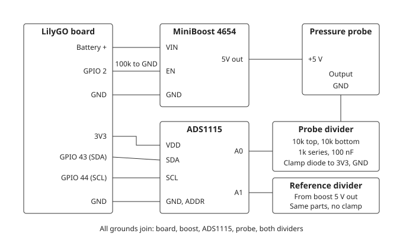
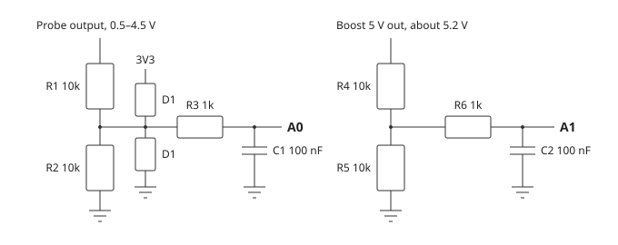

# Water pressure probe circuit

Proposed hardware for a battery-powered 5 V water pressure probe, read through an
ADS1115. No FSD requirement covers it yet, and it has not been built. Figures come
from distributor pages and memory; check them against current datasheets.

Everything below except the board itself sits on the water probe add-on board, its
own ADS1115 included, so only power, I2C and the boost enable cross the 6-pin water
connector to the carrier ([wiring.md](wiring/wiring.md#carrier-and-add-on-boards)).
The divider and clamp nodes stay short and never leave the add-on board.

## Parts

- LilyGO T-Display-S3 AMOLED.
- ADS1115 on the add-on board, on the BME280's I2C bus (GPIO 43/44), powered from 3V3,
  address `0x48`. Its power-down current, about 0.5 µA, is all it draws in sleep.
- Adafruit MiniBoost 5V 1A (product 4654, TPS61023), chosen for its true output
  disconnect when `EN` is low. Bare MCP1640/MCP1640B or TPS61023 suit a custom
  board; the MCP1640C/D pass the input to the output when off, so they do not.
- A 0.5–4.5 V ratiometric probe, rated at 1.5–2 times the highest water pressure. Not
  chosen.

## Connections

| Connection | Parts | Purpose |
|------------|-------|---------|
| Probe output → A0 | 10 kΩ output to node, 10 kΩ node to GND, 1 kΩ in series to A0, 100 nF A0 to GND | Scales 4.5 V to about 2.3 V; filters and protects the input |
| Clamp | Two 1N5711: the divider node, before the 1 kΩ, to 3V3 and to GND | Limits a fault on the probe wire; the 1 kΩ then protects A0 |
| Boost 5 V → A1 | The same divider, 1 kΩ and 100 nF, no clamp; resistors 1% or better, matched between dividers | The reference of the ratio |
| 5 V at the probe | 10 µF and 100 nF to GND | Steadies the supply, reduces boost ripple |
| ADS1115 VDD | 100 nF to GND, close to the chip (often on the breakout) | Decoupling |
| VSYS → boost VIN | | The battery/system rail, as for the loop; at most 5.5 V, the boost's input limit |
| GPIO 2 → EN | 100 kΩ EN to GND, on the add-on board | Probe off through sleep and resets, and with the board unplugged |
| ADDR | To GND | Address `0x48`; the BME280 is `0x76` |

## Divider parts

| Ref | Part | Spec | Note |
|-----|------|------|------|
| R1, R2, R4, R5 | 10 kΩ thin film | 0.1%, 25 ppm/°C, 0603 or 0805, at least 0.1 W | Matching sets the accuracy: 1% parts allow up to about 1.1% of full scale, 0.1% parts about 0.11% |
| R3, R6 | 1 kΩ | 1%, 0603 or 0805, at least 0.1 W | Keep the two equal |
| C1, C2 | 100 nF ceramic | X7R, at least 10 V, 0603 or 0805 | Settles in about 6 ms; wait for it before reading |
| D1, D2 | 1N5711 Schottky, through-hole (DO-35) | 70 V, about 15 mA, about 200 nA maximum leakage at 50 V | D1: anode to the node, cathode (band) to 3V3. D2: cathode (band) to the node, anode to GND. R1 limits a 24 V fault to about 2 mA. Leakage flows through about 5 kΩ and does not cancel: 1 µA is 5 mV. Compare A0 with and without the diodes |

A custom board can use one BAT54S (30 V, 200 mA, SOT-23) in place of D1 and D2; BAT85
is a through-hole substitute, with higher leakage (about 2 µA maximum at 25 V).

Node voltages: A0 reaches about 2.34 V and A1 about 2.6 V with the boost at 5.2 V, both
inside the ±4.096 V range. The reference divider draws about 260 µA, only while the boost
is on.

## Reading

`psi = full_scale × (A0 / A1 − 0.1) / 0.8`. With equal dividers, the boost's voltage
and its drift cancel.

1. Set GPIO 2 high.
2. Wait for the probe to warm up: 50 ms to start with, then as measured at bring-up.
3. Read A1 and A0 in single-shot mode at the ±4.096 V range.
4. Set GPIO 2 low.

## To check before wiring

1. **GPIO 2.** The firmware does not use it, and it is an RTC pin that is not a strapping
   pin. LilyGO's [pinout picture](wiring/lilygo-t-display-s3-amoled-pinout.jpg) puts it on the
   left header, third pin from the top; check the silkscreen. GPIO 4 is
   the battery sense and GPIO 21 the user key.
2. **VSYS.** The boost takes VSYS, the battery/system rail the loop also uses. With USB
   unplugged, check with a meter that VSYS carries the battery voltage; with USB plugged
   in, that it stays at or below 5.5 V. Do not feed VIN from 3V3.
3. **MiniBoost EN.** Whether the breakout pulls `EN` up is unconfirmed. Measure `EN` with
   only VIN and GND connected. If it sits high, remove that pull-up, or use a stronger
   pull-down, or hold GPIO 2 low through deep sleep.
4. **Probe load.** The divider loads the probe with about 20 kΩ; compare it with the
   probe's minimum load.
5. **I2C pull-ups.** Check the total with the BME280, the ADS1115 and the Notecard fitted:
   at or above about 2.2 kΩ.

## Installation

Keep the electronics dry and strain-relieve the probe cable. Metal pipes can be earthed,
so a mains or computer USB connection can add a ground path through the probe; test on
battery. Long cable runs may need more input protection.

## Firmware notes

- A shared `ads1115` component with a pure core; `bme280` may need to accept a shared bus.
- The water value is 16 bits in 0.01 psi, so RTC memory and record sizes stay the same.
  The flash log reserves it (`FL_WATER_NONE` is no reading, FR-26.4).
- Shown in psi on the page, JSON, averages, emails and CSV. Line 4 has no room, so water
  needs its own display line. A fault shows `--` and stops nothing.
- Probe full-scale pressure is a portal setting.

## Order of work

1. Requirements in the FSD.
2. A commissioning program: ADS1115, boost switching, warm-up time, with a variable
   voltage in place of the probe.
3. The driver and shared bus.
4. Integration with readings, averages, emails, log and display.
5. Accuracy against a reference gauge, and battery current in sleep, reading and email.
