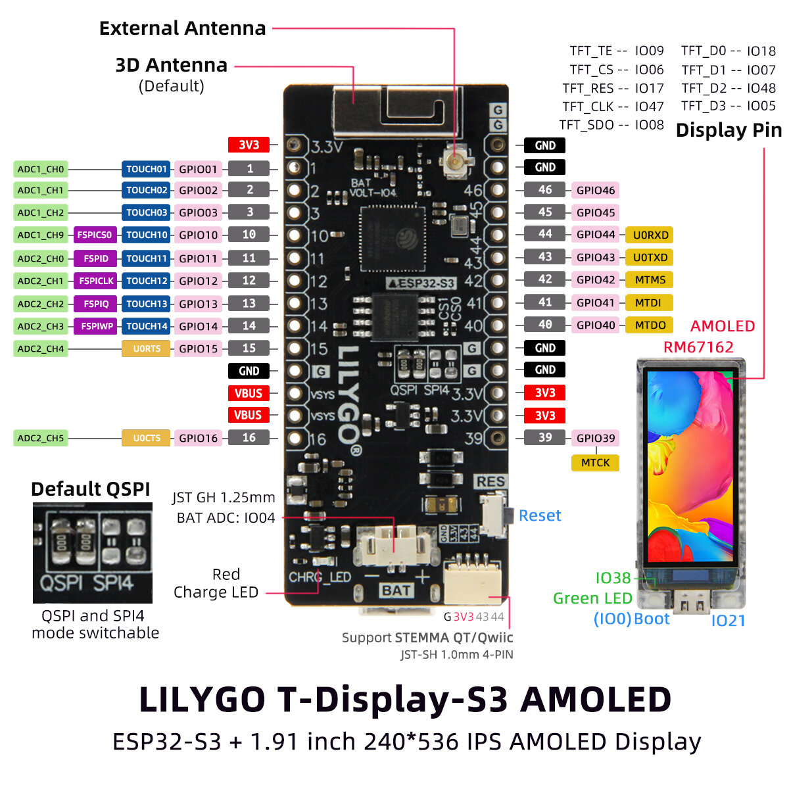
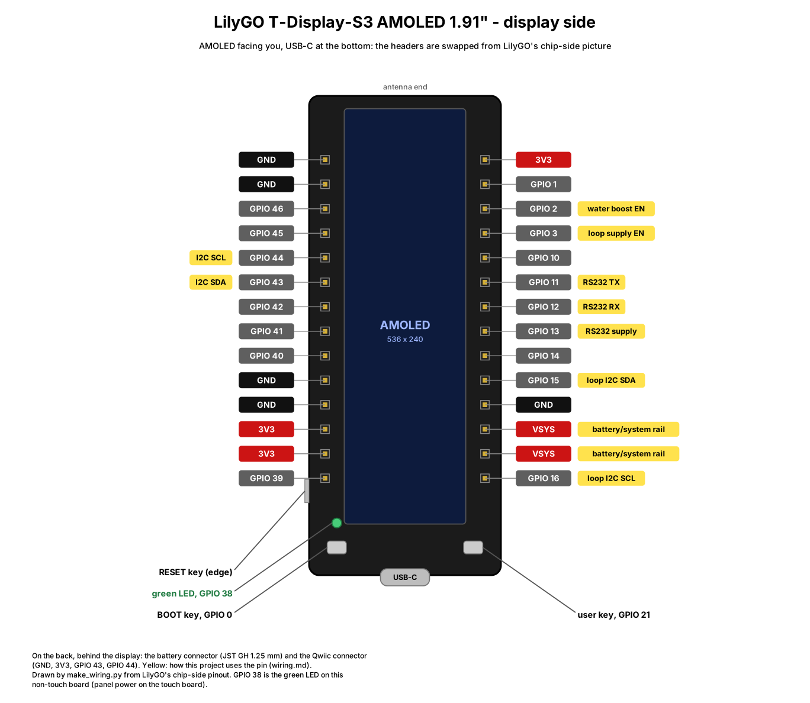

# Wiring diagrams (Fritzing)

Fritzing sketches of what is wired to the LilyGO T-Display-S3 AMOLED 1.91", one
sheet per subsystem. Each `.fzz` opens in Fritzing 1.0 or later with no extra
parts library: every part is a simple custom part embedded in the sketch, and
it lands in the "Temp" bin when the sketch opens. Wires are drawn in the
breadboard view. The schematic and PCB views show only ratsnest lines, so route
them in Fritzing if you need them.

The sketches, pictures and parts come from [`make_wiring.py`](make_wiring.py).
Change the script, never the generated files, then regenerate:

```bash
pip install cairosvg   # only for the PNGs
python3 docs/Method/project/wiring/make_wiring.py
```

The script exits non-zero if a wire runs through a part or along a wire of
another signal.

The board is drawn from the back (the chip side), the way LilyGO's pinout
picture shows it, with the USB-C end at the bottom. With the AMOLED facing you,
the two headers swap sides. Pins in yellow are used on that sheet. Title-bar
colours give each part's status: green means firmware on main, blue means in the
FSD but not built yet, and orange means proposed and not in the FSD.

| Sheet | Status | Board pins |
|---|---|---|
| [1 Board, battery, BME280, Notecard](wiring-1-board-bme280-notecard.png) ([.fzz](wiring-1-board-bme280-notecard.fzz)) | BME280 (FSD §23) and Notecarrier-X v1.3 (§33) on main | GPIO 43 SDA, GPIO 44 SCL, 3V3, GND, BAT JST, Qwiic |
| [2 4-20 mA loop input](wiring-2-loop-4-20ma.png) ([.fzz](wiring-2-loop-4-20ma.fzz)) | On main (FSD §29), circuit in [loop-circuit.md](../loop-circuit.md) | GPIO 3 supply enable and isolator power, VSYS, GPIO 15/16 loop bus, GND |
| [3 Water pressure probe](wiring-3-water-probe.png) ([.fzz](wiring-3-water-probe.fzz)) | Proposed ([water-probe-circuit.md](../water-probe-circuit.md)) | GPIO 2 boost enable, VSYS, GPIO 43/44, 3V3, GND |
| [4 RS232 instrument](wiring-4-rs232.png) ([.fzz](wiring-4-rs232.fzz)) | Specified (FSD §30), circuit in [rs232-circuit.md](../rs232-circuit.md) | GPIO 11 TX, GPIO 12 RX, GPIO 13 transceiver supply, GND |
| [5 Blues cellular uplink](wiring-5-blues-cellular.png) ([.fzz](wiring-5-blues-cellular.fzz)) | On main (FSD §33), hardware in [blues-cellular.md](../blues-cellular.md) | Qwiic GND, GPIO 43 SDA, GPIO 44 SCL (3V3 not connected) |
| [6 Blues cellular, direct wiring](wiring-6-blues-cellular-direct.png) ([.fzz](wiring-6-blues-cellular-direct.fzz)) | On main (FSD §33.2, the alternative to sheet 5) | GND, GPIO 43 SDA, GPIO 44 SCL soldered to the Notecarrier-X header (VIO not connected) |
| [7 Waveshare board, e-paper and OLED](wiring-7-ws-displays.png) ([.fzz](wiring-7-ws-displays.fzz)) | Specified (FSD §35.2, §36, FR-35.25), details in [ws-displays.md](../ws-displays.md); the board's GPIOs drawn in number order, not header order | GPIO 7 CLK, 8 MOSI, 10 DC shared; e-paper CS 3, BUSY 1, RST 20; OLED CS 9 (10 kΩ to GND), RES 19; 3V3, GND |
| [8 Waveshare board, off-board key and LED](wiring-8-ws-key.png) ([.fzz](wiring-8-ws-key.fzz)) | On main (FSD §35.2, FR-35.3, FR-35.18); the board's GPIOs drawn in number order, not header order | Key GPIO 12 to GND (10 kΩ to 3V3, 100 nF to GND, 1 kΩ in series); LED GPIO 13 through 150 Ω; 3V3, GND |

The I2C devices on the board's bus share GPIO 43/44: the BME280 at 0x76, the
water ADS1115 at 0x48 and the Notecard at 0x17. The loop ADS1115 (0x49) has its
own bus on GPIO 15/16, behind the isolator, whose board side GPIO 3 powers only
while the loop is read. Each sheet draws its add-on wired straight to the header
pins; on the carrier those wires pass through the add-on's connector, below.
The BOOT key (GPIO 0), the user key (GPIO 21) and the green LED (GPIO 38) are on
the board, so nothing is wired to them.

## Carrier and add-on boards

The T-Display-S3 and the BME280 sit on a carrier perfboard. Each add-on is a board of
its own: everything a sheet draws for it, its pull-down and, for the analog ones, its
own ADS1115 included, so only power, switch lines and digital buses cross a connector.
The carrier has one keyed through-hole JST-XH (2.5 mm) socket per add-on, each with a
different pin count, so a board fits only its own socket. Pin 1 is GND on every one.
Over four to six pins the 2.5 mm pitch fits 0.1" perfboard.

| Socket | Add-on | Pins 1 – n | Draw |
|--------|--------|------------|------|
| 5-pin XH | 4-20 mA loop (sheet 2) | GND, VSYS, GPIO 3, GPIO 15 SDA, GPIO 16 SCL | 0.25 – 0.35 A on VSYS for about 0.3 s a reading |
| 6-pin XH | Water probe (sheet 3) | GND, VSYS, 3V3, GPIO 43 SDA, GPIO 44 SCL, GPIO 2 | About 0.5 µA on 3V3 in sleep (ADS1115 powered down) |
| 4-pin XH | RS232 (sheet 4) | GND, GPIO 13, GPIO 11 TX, GPIO 12 RX | Up to about 6 mA from GPIO 13 while the port is on |
| 4-pin Qwiic (JST-SH) | Notecarrier-X (sheets 1, 5) | GND, not connected, GPIO 43 SDA, GPIO 44 SCL | None from the board: the Notecarrier's own LiPo or USB powers it |
| Solder pads, no socket | Notecarrier-X, direct wiring (sheet 6) | GND, GPIO 43 SDA, GPIO 44 SCL to its header | The same as Qwiic |

- **I2C fan-out.** GPIO 43/44 run on the carrier to the BME280, the water socket and the
  Qwiic socket, so the board's own Qwiic connector stays free. The Notecard has its own
  10 kΩ pull-ups to its VIO, and each breakout adds its own: keep the parallel total at or
  above about 2.2 kΩ, removing a breakout's pull-ups if needed.
- **Notecard 3.3 V.** Leave the Qwiic cable's red wire unconnected at the carrier, so
  the board's 3.3 V and the Notecarrier's regulator are never tied together.
- **Unplugged add-ons.** Each switch line's pull-down is on its add-on, so a socket
  with nothing fitted leaves its pins floating; the firmware drives them only while its
  add-on is on. An add-on that is on but not fitted gives no value, as a fault does.
- **Fitting.** Fit or remove a board only with USB unplugged and the battery
  disconnected.

## Header pins



LilyGO's pinout picture of the board, chip side up with the USB-C end at the
bottom; the AMOLED is drawn beside it. Source:
[Xinyuan-LilyGO/T-Display-S3-AMOLED](https://github.com/Xinyuan-LilyGO/T-Display-S3-AMOLED),
© 2023 Xinyuan-LilyGO, MIT License
([notice](lilygo-t-display-s3-amoled-pinout.LICENSE)).



The same board from the display face, USB-C still at the bottom, so the two
headers swap sides; the keys, the green LED and the RESET key are where you
see them. Yellow tags give each pin's use in this project. `make_wiring.py`
draws it ([SVG](pinout-display-side.svg)). The header pins, chip side up, top to
bottom:

| Left header | Right header |
|---|---|
| 3V3, 1, 2, 3, 10, 11, 12, 13, 14, 15, GND, VSYS, VSYS, 16 | GND, GND, 46, 45, 44, 43, 42, 41, 40, GND, GND, 3V3, 3V3, 39 |

The Qwiic (STEMMA QT) connector carries GND, 3V3, GPIO 43 and GPIO 44. The
battery connector is a JST GH 1.25 mm.

## To check before wiring

1. **VSYS.** LilyGO's picture labels these two pins VBUS, but the silkscreen
   says VSYS. Sheet 2 feeds the loop supply from them as the battery/system
   rail. With USB unplugged, check with a meter that they carry the battery
   voltage.
2. **Loop circuit.** The parts, their values and the checks before wiring are
   in [loop-circuit.md](../loop-circuit.md). Sheet 2 draws the load switch and
   the 3.3 V regulator as blocks; their transistors and resistors are drawn
   there.
3. **Water probe.** The checks in
   [water-probe-circuit.md](../water-probe-circuit.md#to-check-before-wiring)
   apply. LilyGO's picture puts GPIO 2 on the left header, third pin from the
   top. The boost takes VSYS, like the loop, so no battery tap is needed.
4. **RS232 transceiver.** The MAX3232 takes its supply from GPIO 13, so it
   draws nothing while the port is off. Its charge-pump and decoupling
   capacitors, the optional RTS line and the checks before wiring are in
   [rs232-circuit.md](../rs232-circuit.md).
