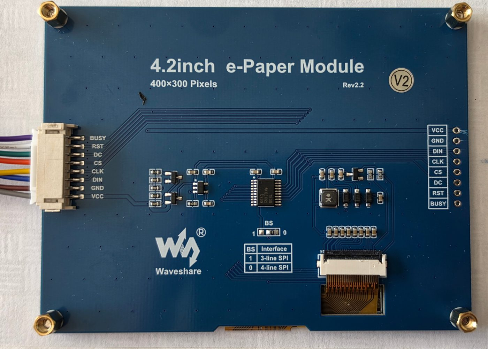
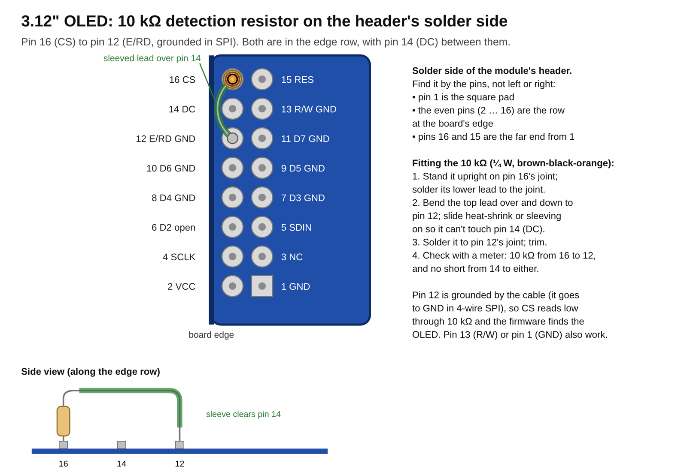
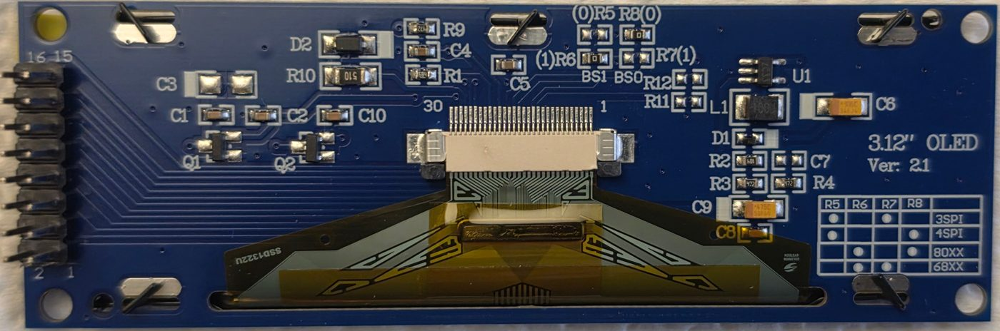

# Displays on the Waveshare SIM7670G board

How the cellular build's two displays (FSD §35.2, §36) are wired and set up: the
3.12" SSD1322 OLED (FR-35.16) and the optional 4.2" e-paper (FR-35.15). Both sit
on SPI2 at the same time. `components/board/include/board.h` holds the pins, and
`dl_display_choose` (FR-35.2) picks which one a wake draws on.

Fritzing sheet 7 ([picture](wiring/wiring-7-ws-displays.png),
[.fzz](wiring/wiring-7-ws-displays.fzz)) draws this wiring; it lists the board's
GPIOs in number order, not in the order they sit on the headers.

## Shared bus

The clock, data and D/C lines go to both displays. Each display has its own chip
select, so only the one being drawn to listens.

| Board pin | Signal | E-paper (8-pin), cable colour | OLED (2 × 8 header) |
|-----------|--------|-------------------------------|---------------------|
| 3V3 | Supply | VCC, grey | VCC, pin 2 (see [Supply](#supply)) |
| GND | Ground | GND, brown | GND, pin 1 |
| GPIO 7 | SPI2 clock | CLK, yellow | D0/SCLK, pin 4 |
| GPIO 8 | SPI2 data | DIN, blue | D1/SDIN, pin 5 |
| GPIO 10 | Data/command | DC, green | DC, pin 14 |
| GPIO 3 | E-paper chip select | CS, orange | — |
| GPIO 20 | E-paper reset | RST, white | — |
| GPIO 1 | E-paper busy (input) | BUSY, purple | — |
| GPIO 9 | OLED chip select, and its detection | — | CS, pin 16, with 10 kΩ to GND |
| GPIO 19 | OLED reset | — | RES, pin 15 |

- The cable colours are those of the cable that comes with Waveshare's 4.2"
  e-Paper Module (V2, Rev2.2); its connector and the 8-pin header beside it are
  labelled on the module's back.

  

- The board's headers carry no silk labels, and the sheet shows the GPIOs in number
  order, not header order. Find each pin with a meter before wiring. GPIO 21
  (the modem's supply) and GPIO 0 (the boot strap) stay free.
- The header GND pins carry the e-paper's refresh current. A poor ground joint
  shows up as refreshes that hang.
- Keep the SPI leads under about 15 cm, with a ground wire alongside each cable.
  A breadboard row or a 3-way Dupont splitter per shared signal joins the two
  displays to one board pin.

## Detection

Either display, both or neither may be plugged in (FR-35.25). At the start of
each window the firmware looks for each display whose setting is `on`, logs L50
(`web: displays epaper=found oled=none`, for example) and chooses among those
found (FR-35.2).

- **E-paper:** found when BUSY (GPIO 1, internal pull-down) rises within 2 ms
  of the software reset. A fitted SSD1683 raises it within about 15 µs and holds
  it for about 4.4 ms; with no panel the pull-down keeps it low. Nothing extra is
  wired.
- **OLED:** found when its CS (GPIO 9) reads low against the internal pull-up.
  Fit a **10 kΩ resistor from CS to GND on the OLED's lead** (at its plug or on
  the module's header). It draws about 0.3 mA while CS is high in a window, and
  nothing in deep sleep. On the header's solder side it stands on pin 16 (CS),
  its top lead sleeved over pin 14 (DC) down to pin 12 (E/RD, grounded by the
  cable):

  

Plug or unplug a display with the power off; the next window sees the change.

## E-paper reset timing

On Waveshare's 4.2" e-Paper Module (V2, SSD1683), a reset pulse held low for
10 ms or more leaves every refresh hanging, with BUSY high until the next reset.
A low of 0.2 to 5 ms works on every run, before and after the controller's deep
sleep, whatever the high time (1 to 20 ms).

| RST low | RST high | Full refresh | Partial refreshes |
|---------|----------|--------------|-------------------|
| 0.2, 1, 2, 5 ms | 1 to 20 ms | 2053 to 2202 ms | 5 of 5 at 335 to 345 ms |
| 10, 20 ms | 2 to 10 ms | hangs | hang |

So the shared `ssd1683` holds RST low for an exact 2 ms (`esp_rom_delay_us`),
never a tick-rounded `vTaskDelay`. Before deep sleep mode 1 it turns off the
analog block and the clock (`0x22 0x83`, `0x20`). `commissioning/ws-epaper-probe`
uses the same sequence.

## OLED module (3.12" OLED Ver 2.1)

The module carries an SSD1322U controller (printed on the flex), a 16-pin 2 × 8
header, a 3.3 V regulator (U1) and the panel's high-voltage boost (L1, D1).

### Interface select

Two 0 Ω links out of R5 to R8 set the interface, following the table on the silk.

| Mode | Fitted |
|------|--------|
| 3-wire SPI | R5, R7 |
| 4-wire SPI (this build) | R5, R8 |
| 8080 parallel (as shipped) | R6, R8 |
| 6800 parallel | R6, R7 |

The module ships with R6 and R8 fitted. For 4-wire SPI, move the part from R6
to R5 (or bridge R5's pads), and leave R8 fitted and R6 and R7 empty.

### Header

Pin 1 is the square pad, at the bottom right as printed. The odd pins (1, 3 …
15) run up one row and the even pins (2, 4 … 16) up the row beside it, so pin 2
sits next to pin 1 and pin 16 is at the far end. The seller's pinout for this
module family (the 2.8" GME25664-40 drawing, the same 16-pin header) gives this
order:

| Pin | Signal | In 4-wire SPI |
|-----|--------|---------------|
| 1 | GND | GND |
| 2 | VCC | 3V3, or 5 V (see [Supply](#supply)) |
| 3 | NC | open |
| 4 | D0/SCLK | GPIO 7 |
| 5 | D1/SDIN | GPIO 8 |
| 6 | D2 | open |
| 7 – 11 | D3 – D7 | GND |
| 12 | E/RD | GND |
| 13 | R/W | GND |
| 14 | DC | GPIO 10 |
| 15 | RES | GPIO 19 |
| 16 | CS | GPIO 9, with 10 kΩ to GND (detection) |

In serial mode the SSD1322 leaves D2 open and lets D3 to D7, E and R/W go to
ground. Tying them low keeps them from floating.

### Reset

The firmware drives RES from GPIO 19 (`BOARD_OLED_RST`), so every start of the
shared `ssd1322` resets the controller, also after a deep sleep or an ESP32
reset, when the OLED's supply never dropped. The module has no reset RC of its
own. GPIO 19 is the ESP32-S3's USB D−, free with the board's USB switch on (the
console runs on the CH343). With it, no header GPIO is left free: further sensors
join the I2C buses.

### Supply

The module's own regulator (U1) has almost no headroom with 3.3 V on VCC. If the
panel is dim or unstable on 3V3, VCC goes to the board's 5 V instead; the logic
lines stay at 3.3 V either way. The OLED draws about 20 to 100 mA, depending on
how much of the screen is lit. The e-paper draws a few mA, and only while it
refreshes.

## Fonts at each panel's pitch

The e-paper's pixel pitch is about 0.21 mm and the OLED's about 0.30 mm, so the
same font is about 40 % larger on the OLED. In characters per row × rows:

| Font | E-paper 400 × 300 | OLED 256 × 64 |
|------|-------------------|---------------|
| 16 × 32 | 25 × 9 | 16 × 2 |
| 12 × 24 | 33 × 12 | 21 × 2 |
| 8 × 16 | 50 × 18 | 32 × 4 |
| 6 × 10 | 66 × 30 | 42 × 6 (FR-35.16) |

The even runs of `commissioning/ws-epaper-probe` show all four fonts on the
e-paper.
